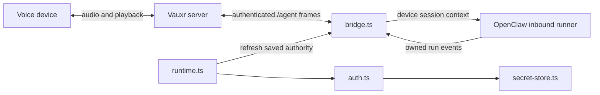

# Explanation: authority, turns and history

A Vauxr integration makes a server's authenticated voice devices available to
OpenClaw. It is not the speech engine or device credential issuer. The server owns
TTS, physical-device authority and playback; OpenClaw owns agent execution and
history. The plugin translates their boundaries. See [reference](reference.md)
for field/limit lookup and [tutorial](tutorial.md) to explore this locally.

## Three checkpoints, not one connected flag

Configuration presence enables a single channel account; it proves neither
credential availability nor socket readiness. Enrollment obtains scoped integration
authority through owner comparison/approval. A matching `agent.ready` proves the
socket authenticated that subject. Owner routing selection is yet another choice:
a connected integration can remain silent if it is not active for voice.

The setup entry exposes channel metadata; full registration constructs a runtime
without I/O. Channel start owns polling/socket lifetime. A new gateway API instance
retires the old runtime so dispatch does not retain stale gateway authority.
HTTP lifecycle polling and socket reconnect are separate loops: runtime polling
uses bounded backoff, while bridge reconnect starts at 1 second and caps at 30.
Neither loop's success proves physical playback.

## Durability is part of authority

One-time credential delivery cannot be retried as a credential download. Request
binding is saved before requesting enrollment; delivered authority is committed,
flushed and read back before ACK. Rotation keeps old and replacement slots together
until replacement-authenticated ACK completes. A readable file after failed fsync
is not sufficient: resumed ACK recommits first. This ordering is visible in the
implementation, not a claim of encryption or protection against host root.

Fail-closed private storage and terminal rejection prevent uncertainty from being
silently treated as valid authority. Lost delivery before save requires fresh owner
approval; lost ACK after save can resume the same saved operation. The detailed
[auth evidence](auth-lifecycle.md) retains historical SDK/peer pins; it should not
be read as current-server certification.

## Identity is not presentation or correlation

| Identifier | Owner / use |
| --- | --- |
| Stable `deviceId` | Authenticated server supplies it; sender policy, device routing and history identity use it. |
| `agent:<agentId>:vauxr:<deviceId>` | Plugin builds the durable OpenClaw history key; incoming session hints are not routing authority. |
| SDK run ID | OpenClaw reports it through `onAgentRunStart`; event correlation uses the exact active turn. |
| Wire run ID | Plugin UUID returned to server for this response, distinct from SDK ID. |
| Friendly title | Validated server metadata only; affects `ConversationLabel`, never map keys or authority. |

Two identically named devices therefore remain distinct. A rename updates display
metadata on a subsequent transcript, without moving history. The older
[friendly-title review](friendly-device-display.md) records its original peer and
SDK evidence; the current bridge uses `agent.*` frames.

## Output retirement is not cancellation

Each device admits one Standard/backend consultation turn at a time. Ordinary
assistant deltas stream to server TTS; message-tool text uses async-local turn
ownership; completed preamble items are forwarded once. Final accumulated text is
not sent as a new delta. Prefix buffering prevents a split `NO_REPLY` sentinel
from being spoken. There is no offline output queue or device audio buffer here.

Socket loss retires output maps and event ownership. It does not abort the SDK
operation or tools. Old work can finish after a new socket admits a replacement;
only the exact current turn may deliver or clean up that turn's state. This is why
a timeout is not safe evidence that a consequential action never happened.

## Realtime separates remembering from doing

`bootstrap` binds an ephemeral media scope to durable device history. `record`
persists fragments without dispatching actions; stable fragment IDs make retries
idempotent. `consult` explicitly runs a backend action and memoizes its promise by
request identity. Consult does not hold the recording tail, so new fragments can
be saved while tools run. `release` drops only the ephemeral scope.

This separation avoids treating every spoken fragment as a fresh backend request.
It does not guarantee audio consumption: `delivered` is a peer assertion and
unconfirmed assistant output is marked in history. Memoization survives reconnect
and includes failures, but retention is currently bounded only by bridge-lifetime
capacity guards. Reconnect is not a capacity reset despite internal error wording;
see [known findings](maintainer-review.md#findings-requiring-follow-up) for this and
other unresolved behavior, rather than inferring a design promise from it.
