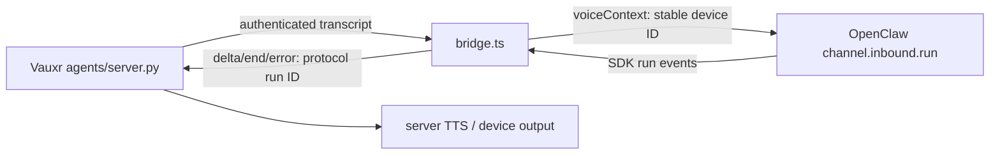

# Maintainer architecture and review evidence

Reviewed 2026-11-09 at plugin `e0f6c103f904363da431f864c8b39712ee1dc329`
(remote `vauxr-ai/vauxr-openclaw`, fresh `develop`). This is a source review,
not live speech, hardware, security certification or exhaustive test coverage.
Only documentation/comments changed; findings below are not behavioral fixes.

## Who owns a voice turn?

`index.ts` registers a gateway-API-owned `VauxrRuntime`, tools and an admin
command. `channel.ts` starts/stops it with channel lifecycle. `runtime.ts`
serializes auth work and polls enrollment/lifecycle with backoff; socket
reconnect is independently owned by `bridge.ts`. Configuration presence is not
connectivity. `agent.ready.agentId` must equal the stored integration subject,
and auth must accept `connected`, before transcripts can dispatch.

The server authenticates device and integration authority. The plugin trusts
that authenticated server to supply device IDs; it does not reauthenticate each
device itself. `voice_context.ts` constructs
`agent:<targetAgent>:vauxr:<deviceId>` and keeps sender identity unchanged.
Only validated `deviceDisplayName` enters `ConversationLabel`. The received
`sessionKey` is not the routing authority. Server-supplied `uiContext` is not
consumed by this revision (open PRs #44/#45 extend UI/context tools).

Each device admits one Standard dispatch at a time; a second transcript while
it is running is ignored. SDK run IDs are registered by `onAgentRunStart`, not
inferred from session keys. Wire run IDs are separate UUIDs. Async-local outbound
message text, stream events, errors and final cleanup require the exact active
turn object. Disconnect/stop retires output maps, not the SDK operation or tools.
A replacement socket can admit a new turn while the retired operation finishes.
There is no plugin audio buffer: playback, interruption and TTS belong to the server.

Realtime uses the same device session history. `bootstrap` obtains context;
`record` persists fragments without dispatch; `consult` runs the backend once per
memoized request key; `release` deletes ephemeral scope, not transcript history.
Non-consult operations serialize per device. Consult is deliberately not the tail,
so recording can continue while it runs. A media timeout/cancel does not cancel
backend tools: inspect action status before retrying with a new request ID.

## Contracts and authority

| Boundary | Implementation / constraints |
| --- | --- |
| Enrollment and rotation | `auth.ts` request/deliver/save/ACK; bound HTTP origin + WS URL; protected replacement persisted before ACK. See [auth evidence](auth-lifecycle.md). |
| Storage | `secret-store.ts`: SDK atomic private files plus strict file/directory fsync/readback; POSIX only, not encryption. |
| HTTP | `transport.ts`: same hostname/scheme for endpoints (ports may differ); 10-second deadline, 1 MiB response bound; no redirects or certificate bypass. `api-client.ts` projects public fields and allowlists commands. |
| WS input | `/agent`: send `agent.auth`, wait for matching `agent.ready`. Standard: `agent.transcript {deviceId,text,deviceDisplayName?}`. Realtime: `agent.realtime.request {requestId,deviceId,session,operation,payload}`. |
| WS output | `agent.response.delta/end/error {deviceId,runId,...}`; delta carries `text`, error carries `message`. Realtime result echoes `deviceId,requestId` with `result` or bounded `error`. |
| Realtime limits | Session token 1–100 alphanumeric/underscore/hyphen; 128 scopes; 4096 memoized request keys; at most 64 fragments per record, each text at most 16000 characters; consult at most 32000 characters. |
| Tools | `tools.ts` exposes listing, announce, constrained control/OTA, physical pairing. No owner administration or credential input/output. Firmware capabilities are minted and consumed internally. |

Peer trace (read-only): server `25469df63362853a2a4daf18cc0a115c6626b6bf`,
`src/vauxr/agents/server.py` (`realtime_request`, `send_transcript`, auth handler,
response admission/correlation), and `src/vauxr/realtime/llm.py` response timeout. HTTP proof/role/ACK
checks were also traced in `src/vauxr/provisioning/integration_http.py`,
`integration.py`, `lifecycle_http.py` and `lifecycle.py` (targeted sections).
Server correlation binds connection/device/admission and first Standard run ID;
Realtime binds connection/device/request ID. Server cancellation drops its waiter,
not backend action authority. The current server package layout differs from the
historical fixture pin `4155222a24316478675e54764cd7fed73fa04145`.

## Findings requiring follow-up

1. **Availability: request-local FORBIDDEN stops every device on the bridge.**
   Server `agents/server.py` response authorization intentionally returns
   `FORBIDDEN` for an unrecognized/unselected device operation without retiring
   shared integration authority. `bridge.ts:handleFrame` calls `stop()` for any
   `FORBIDDEN`, clearing all active turns/subscription. If one stale device result
   receives that error, unrelated device output is retired too; runtime polling
   may recover later. Confirm with a two-device stale-result fixture and keep
   request denial distinct from credential rejection. High confidence from both
   implementations; no live reproduction performed.
2. **Availability: reconnect does not reset Realtime capacity.**
   `handleRealtime` retains fulfilled/rejected promises and device tails for the
   lifetime of the bridge. At 4096 distinct keys it rejects even `release` with an
   internal message recommending reconnect, but `stop`/`retireTurns` do not clear
   those maps or `conversations`. Socket reconnect therefore cannot recover this
   limit; gateway runtime replacement can. Evaluate bounded retention without
   losing retry deduplication or admitting duplicate tool actions. Source-confirmed.
3. **Routing drift: nested config accepts a target that dispatch ignores.**
   `index.ts:resolveConfig` and `channel.ts:resolveSection` accept
   `plugins.entries.vauxr.config.vauxr`; `bridge.ts:resolveTargetAgentId` only reads
   channel config and flat plugin config before agent defaults. A nested
   `targetAgent` different from the default routes Standard and Realtime to the
   wrong agent. Validate all supported config slots before a functional repair.
4. **Verification drift:** README previously named SDK 2026.9.3 and server
   `16968a7`; package/test pin is SDK 2026.9.4 and server `4155222`. Corrected
   README, but old auth/title documents retain their historical evidence pins,
   not current compatibility proof. Current peer imports use `vauxr.*` whereas
   `test/server-contract.py` and `test/restart-server.py` import old top-level
   modules. Do not bypass the exact-head assertion to claim current coverage.

## Coverage ledger

All 12 first-party `src/*.ts` modules plus both root entrypoints were read.
This ledger distinguishes implementation coverage from test review depth.

| Subsystem | Inspected paths | Review depth / evidence |
| --- | --- | --- |
| Gateway lifecycle/config | `index.ts`, `setup-entry.ts`, `src/channel.ts`, `src/runtime.ts`, `src/defaults.ts` | Full implementation; registration/restart/outbound tests inventoried and executed. |
| Authority/storage/HTTP | `src/auth.ts`, `src/secret-store.ts`, `src/transport.ts`, `src/api-client.ts` | Full implementation; auth failure/storage/scoped-tool/transport test cases inventoried and executed. |
| Dispatch/history/tools | `src/bridge.ts`, `src/realtime.ts`, `src/voice_context.ts`, `src/tools.ts` | Full implementation; `test/realtime.test.mjs`, `test/bridge-delivery.test.mjs` read in full; transport fixture/auth/TLS assertions read in detail. |
| Contract/restart harnesses | `test/real-contract.test.mjs`, `test/server-contract.py`, `test/bridge-restart.test.mjs`, `test/restart-server.py` | Entrypoints, head/import gates and setup inspected; remaining test bodies inventoried, not all read line-by-line. |
| Test inventory | `test/auth-failures.test.mjs`, `test/bridge-delivery.test.mjs`, `test/bridge-restart.test.mjs`, `test/friendly-display.test.mjs`, `test/plugin-wiring.test.mjs`, `test/real-contract.test.mjs`, `test/realtime.test.mjs`, `test/realtime-title.test.mjs`, `test/scoped-tools.test.mjs`, `test/secret-store.test.mjs`, `test/transport-bridge.test.mjs` | All named cases inventoried; execution below. No claim of exhaustive assertion audit. |
| Build/publication | `package.json`, `tsconfig.json`, `openclaw.plugin.json`, `.github/workflows/publish.yml`, `.gitignore` | Manifest/schema and publish pipeline read. Workflow builds/releases on main or release; no PR test job in this checkout. |
| Existing docs | `README.md`, `docs/auth-lifecycle.md`, `docs/friendly-device-display.md`, `docs/specs/channel-turn-refactor.md` | README/auth read; title/spec architecture sections inspected; historical spec marked as such. |

Excluded: `package-lock.json` transitive dependency audit, dependency/vendor code,
LICENSE legal audit, generated `dist`, JSON fixture byte/content audit (suite gate
exists), full historical-spec analysis, peer firmware/assistant internals. No live
gateway/owner UI, hardware, speech-provider or media-output acceptance. Existing
open PRs #44/#45 inspected for scope/title overlap; no code incorporated.

## Validation

See the verification result recorded below. Dependencies reused from the existing
local checkout via ignored `node_modules` symlink; no dependency or lockfile edits.
No Playwright, deployment, merge, OTA or runtime configuration change performed.

- `npm test`: build passed; 58 tests, 45 passed, 11 failed, 2 skipped.
  A pristine `git archive` of the pinned plugin base, with identical dependencies
  and environment, reproduced the same failing cases and totals.
- Four SDK/history failures involved the host's newer state schema (22 versus
  pinned SDK support for 17). A disposable `OPENCLAW_STATE_DIR` run removed those:
  58 tests, 49 passed, 7 failed, 2 skipped. The remaining failures are the TLS
  parent plus six child scenarios (trusted/auth HTTP expectations), also present
  on the pristine base; root cause not resolved in this docs-only task.
- Focused existing auth-failure, outbound-ownership, plugin-wiring, scoped-tool
  and secret-store tests: 31 tests passed, zero failures/skips.
- Both real-server fixtures skipped without their explicit source variables;
  current peer head/layout cannot satisfy the historical contract gate. No claim
  that current peer contracts passed executable integration verification.
- `git diff --check` and local relative Markdown link-target check passed.
  Mermaid reviewed as GitHub-compatible source; rendered GitHub view unverified.
